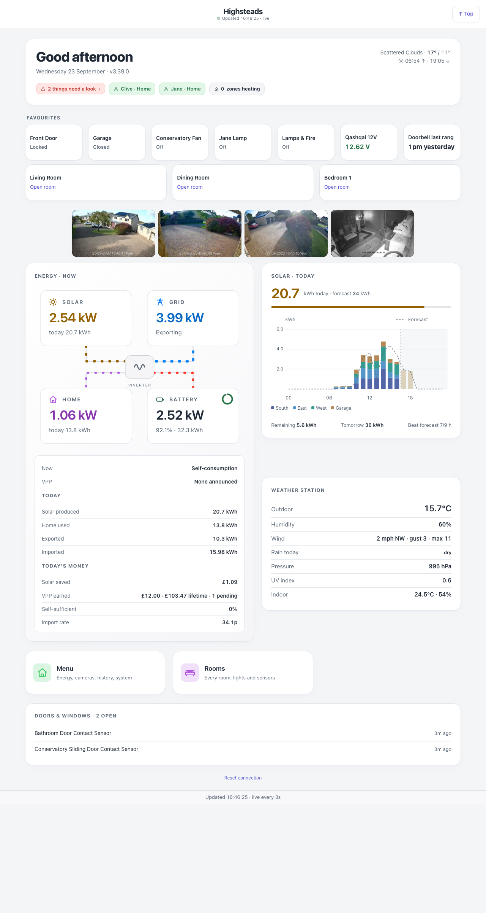

# Dashboards for Indigo

**Your house on a screen — energy, cameras, heating, every room, and the whole day replayed.**

**Version:** 3.67.0 | **Author:** CliveS & Claude | **Needs:** Indigo 2025.2

**[Read the full guide](https://highsteads.github.io/Dashboards/)** — setting up, a page of notes for every one of the 22 pages, and what to do when something goes wrong.

*Earlier layout shown above. Camera names, picture ages and the new view controls were added in 3.65.0.*

The video tour and its downloadable stills show the earlier layout. The current camera controls are described in [the camera guide](https://highsteads.github.io/Dashboards/pages/cameras.html).

**[Watch the five-minute tour](https://highsteads.github.io/Dashboards/#watch-a-five-minute-tour)** · [download the video](https://highsteads.github.io/Dashboards/video/tour.mp4) · [download every page as stills](https://highsteads.github.io/Dashboards/video/dashboards-screenshots.zip)

---

## What it does

This plugin gives [Indigo](https://www.indigodomo.com) a set of web pages for your house, built for an iPad, a phone in your pocket and a laptop on the desk. Indigo's own web server hands them out, so there is no app to install, no cloud account, and nothing leaves the house.

- **A hub page** says at a glance whether anything needs a look, who is home, how the heating is doing, and shows your favourite controls and a strip of camera pictures.
- **A page for every room**, built from your Indigo device folders, with lights, sockets, blinds, sensors, doors and cameras, and buttons that check the device really did what you asked.
- **Live camera video** from IP cameras with a video stream, with priority for the camera you select, full screen and an all-camera grid. Slow connections use still pictures, and every tile says how fresh its picture is.
- **The solar and battery picture, and what the house costs to run**, for anyone with a Sigenergy solar and battery system, through my free SigenEnergyManager plugin.
- **Any day replayed** — presence, lights, doors and heating hour by hour, and a chart of anything Indigo has recorded, from the SQL Logger that comes with Indigo.
- **Alerts** when a device or variable changes, sent to your phone by Pushover or by email with no page open, or shown as a browser notification.
- **Heating, weather, Wi-Fi, every mains meter and the Indigo server's own health**, each on a page of its own.
- **A read-only guest link** for a wall tablet or a visitor's phone, which can look at every page but switch nothing.

Every page is my interpretation of my own house — my rooms, my solar and battery, my washing machine. Yours will be different, so take the ideas that suit your house and leave the rest. Every page, the plugin and the guide were written by Claude from conversation, and [Start with nothing but Claude](https://highsteads.github.io/Dashboards/no-coding-needed.html) shows how to have it build the pages you want without writing a line yourself.

## What it works with

It needs Indigo 2025.2 and nothing else. Each of these adds to it, and a page that needs one that you do not have says so or leaves itself out:

| Add this | And you get |
|---|---|
| **ffmpeg** and **go2rtc**, two free programs installed with Homebrew | The cameras. Both are needed |
| The **SQL Logger** plugin, which comes with Indigo | The Timeline, charts, and the history on the meter pages |
| My free **SigenEnergyManager** plugin, for any Sigenergy solar and battery system | The Energy and Cost pages, and the hub's energy cards |
| **EvoHomeControl** | The boost and force buttons on the Heating page. Temperatures and setpoints work with any thermostat |
| **UniFiHealth** 0.2.0 or later | The Wi-Fi pages |
| The **Pushover** plugin and a Pushover user key | Alerts on your phone. Without it an alert can still go by email |
| An **OpenWeatherMap** key | Sunset, the day's high and low, UV and conditions on the hub's Weather card |
| [Tailscale](https://tailscale.com) | The dashboards, live cameras included, away from home, with nothing opened up to the internet |

## The pages

Eighteen pages you use, plus four that hold the whole thing together (the menu, Settings, Setup and Guest). Each one has its own page of notes in the guide.

| Page | What it is for |
|---|---|
| **[Hub](docs/pages/hub.md)** | The front page: whether anything needs a look, who is home, the heating, your favourites, the cameras, the battery and the solar day so far |
| **[Menu](docs/pages/menu.md)** | Every page in one list, with each room as its own entry |
| **[Room](docs/pages/room.md)** | One room end to end — lights and sockets with real controls, blinds, sensors, cameras and doors |
| **[Active](docs/pages/active.md)** | Everything that is on right now, across the whole house |
| **[Scenes](docs/pages/scenes.md)** | Every Indigo action group as a button, each saying what actually happened |
| **[Energy](docs/pages/energy.md)** | The solar and battery picture, and when to run the washing. Needs SigenEnergyManager |
| **[Cost](docs/pages/cost.md)** | What the house costs to run, day by day. Needs SigenEnergyManager |
| **[Flow](docs/pages/flow.md)** | The house, live, drawn the way the Sigenergy app draws it. Needs SigenEnergyManager |
| **[Mains](docs/pages/mains.md)** | Every mains meter and how far each one disagrees with the others |
| **[Meter](docs/pages/meter.md)** | One meter in detail — its live reading, its rank and its history |
| **[Timeline](docs/pages/timeline.md)** | A day replayed, presence night by night, a chart of anything recorded, and the house diary |
| **[Heating](docs/pages/heating.md)** | Every heating zone, its temperature and its setpoint, with controls |
| **[Cameras](docs/pages/cameras.md)** | Live video or fresh stills, selected view or full grid, and full screen |
| **[Weather](docs/pages/ecowitt.md)** | The weather station in full |
| **[System](docs/pages/system-health.md)** | The Indigo Mac's own health, devices in trouble, and what the automation is about to do |
| **[Wi-Fi](docs/pages/wifi.md)** | Every access point and how hard it is working, with [a page for each one](docs/pages/wifi-ap.md). Needs UniFiHealth |
| **[Alerts](docs/pages/alerts.md)** | The alert rules, how each one reaches you, and Indigo's recent errors |
| **[Settings](docs/pages/settings.md)** | Favourites, links, cameras, rooms, scenes and security, set in the browser |
| **[Setup](docs/pages/setup.md)** and **[Guest](docs/pages/guest.md)** | Pairing a browser, and pairing a look-only guest device |

## Installing

1. Go to the [Releases page](https://github.com/Highsteads/Dashboards/releases/latest) and download `Dashboards.indigoPlugin.zip`
2. Unzip the downloaded file — you will get `Dashboards.indigoPlugin`
3. Double-click `Dashboards.indigoPlugin` — Indigo will install it automatically

For the cameras, also install ffmpeg and go2rtc on the Indigo Mac, which the [guide](https://highsteads.github.io/Dashboards/getting-started.html) explains.

## Setting it up

1. Open **Plugins → Dashboards → Configure**, fill in **Indigo API Key** with an API key from your Indigo account, add the **Camera User** and **Camera Password** your cameras share if you have cameras (a camera with a different login gets its own under **Camera Logins**), and click **Save**.
2. Pair each phone, tablet or computer once with **Plugins → Dashboards → Generate One-Time Setup Link (+QR)** — open the link on the device, or scan the QR code with its camera, and it is paired with nothing to type.
3. Open the hub, go to the Settings page, and on the Rooms card tick the Indigo device folders that are your rooms. Until you do, there are no room pages.
4. Run **Plugins → Dashboards → Test Dashboards Setup**, which checks the lot and writes a line for each check into the Indigo event log.

The [Getting started](https://highsteads.github.io/Dashboards/getting-started.html) page goes through each step, and adding cameras, guest devices and the home-screen app.

## What's new

**3.67.0** (29-Oct-2026) - **Tap the battery or the grid on the Flow page to see what they are doing.** The SigenStor reading opens a pop-up that says, in plain words, what the battery manager is doing and why, how much charge should be left at dawn, how long the battery would run the house in a power cut at what it is using now, the battery's health and pack temperatures, and what it has taken in and given out today. It also warns of a VPP export, a storm warning or the hold on exports after a power cut. The GRID reading opens one with the price band you are in, what a unit costs to buy and sell, when that changes and to what, what the house has bought and sold today, whether the supply voltage and frequency are within their limits, any booked Saving Session, and the last power cut. Both stay live while open and say nothing they have no figure for. They show information only: nothing on them changes what the battery does. The percentage beside SigenStor still opens the card's own battery history.

**3.66.1** (29-Oct-2026) - **Tap the car charger on the Flow page to reach the Zappi.** The AC CHARGER reading opens the Energy page at the car charger card, where the mode and boost buttons are. That card now lands with its heading clear of the top bar, from the hub's link too.

**3.66.0** (29-Oct-2026) - **A new Flow page: the house, live, the way the Sigenergy app draws it.** Solar, the SigenStor battery, the grid, the house and the car charger sit on a picture of a house, with lines of light running along the cables in the direction power is moving, in a light look by day and a night look after sunset. Tap Solar for each string's voltage, current, power and today's energy with a chart through the day, or Home for every metered plug sorted by what it is drawing. Below are today's energy, the battery level, a chart of the day from midnight with a dashed forecast for the rest of it, and a diagram of where the energy went over a day, week, month, year or all time. The picture and card are Jean-Yves Avenard's Sigenergy Flow Card for Home Assistant, used unchanged under the Apache License 2.0; Dashboards feeds it from SigenEnergyManager, the Zappi plugin and the weather station. The Flow tile sits beside Energy and Cost on the menu and only appears where SigenEnergyManager is installed.

## Acknowledgements

The Flow page's picture and card are the [Sigenergy Flow Card](https://github.com/jyavenard/sigenergy-flow-card) by Jean-Yves Avenard, © 2025-2026, used unchanged under the [Apache License 2.0](Dashboards.indigoPlugin/Contents/Resources/static/pages/sigenergy-flow-card.LICENSE.txt). Thank you, Jean-Yves.

## Authors & licence

Vibed into existence by **CliveS**, who knew what he wanted, argued until he got it, and tested it on a real house. Typed at inhuman speed by **Claude** (Anthropic), who mostly did as it was told.

© 2026 CliveS · [MIT licence](LICENSE) — copy it, fork it, bend it, break it, fix it, ship it. If it breaks, you get to keep both pieces.
