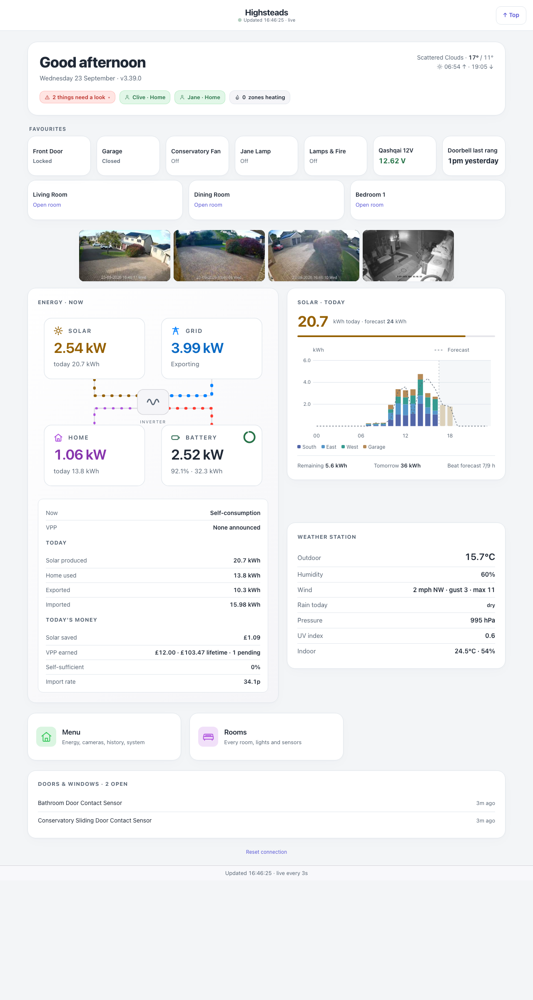

# Dashboards for Indigo

**Your house on a screen — energy, cameras, heating, every room, and the whole day replayed.**

**Version:** 3.73.14 | **Author:** CliveS & Claude | **Needs:** Indigo 2025.2

**[Read the full guide](https://highsteads.github.io/Dashboards/)** — setting up, a page of notes for every one of the 24 pages, and what to do when something goes wrong.

*Earlier layout shown above. Camera names, picture ages and the new view controls were added in 3.65.0.*

The video tour and its downloadable stills show the earlier layout, including the Laundry and Grid Carbon card removed in 3.69.2. The current camera controls are described in [the camera guide](https://highsteads.github.io/Dashboards/pages/cameras.html).

**[Watch the five-minute tour](https://highsteads.github.io/Dashboards/#watch-a-five-minute-tour)** · [download the video](https://highsteads.github.io/Dashboards/video/tour.mp4) · [download every page as stills](https://highsteads.github.io/Dashboards/video/dashboards-screenshots.zip)

---

## What it does

This plugin gives [Indigo](https://www.indigodomo.com) a set of web pages for your house, built for an iPad, a phone in your pocket and a laptop on the desk. Indigo's own web server hands them out, so there is no app to install, no cloud account, and nothing leaves the house.

- **A hub page** says at a glance whether anything needs a look, who is home, how the heating is doing, and shows your favourite controls and a strip of camera pictures.
- **A page for every room**, built from your Indigo device folders, with lights, sockets, blinds, sensors, doors and cameras, and buttons that check the device really did what you asked.
- **Live camera video** from IP cameras with a video stream, with priority for the camera you select, full screen and an all-camera grid. Slow connections use still pictures, and every tile says how fresh its picture is.
- **The solar and battery picture, and what the house costs to run**, for anyone with a Sigenergy solar and battery system, through my free SigenEnergyManager plugin.
- **Any day replayed** — presence, lights, doors and heating hour by hour, and a chart of anything Indigo has recorded, from the SQL Logger that comes with Indigo.
- **Alerts** when a device or variable changes, sent to your phone by Pushover or by email with no page open, or shown as a browser notification.
- **Heating, weather, Wi-Fi, every mains meter and the Indigo server's own health**, each on a page of its own.
- **A read-only guest link** for a wall tablet or a visitor's phone, which can look at every page but switch nothing.

Every page is my interpretation of my own house — my rooms, my solar and battery, my washing machine. Yours will be different, so take the ideas that suit your house and leave the rest. Every page, the plugin and the guide were written by Claude from conversation, and [Start with nothing but Claude](https://highsteads.github.io/Dashboards/no-coding-needed.html) shows how to have it build the pages you want without writing a line yourself.

## What it works with

It needs Indigo 2025.2 and nothing else. Each of these adds to it, and a page that needs one that you do not have says so or leaves itself out:

| Add this | And you get |
|---|---|
| **ffmpeg** and **go2rtc**, two free programs installed with Homebrew | The cameras. Both are needed |
| The **SQL Logger** plugin, which comes with Indigo | The Timeline, charts, the history on the meter pages, and the past days on the Plugs page |
| My free **SigenEnergyManager** plugin, for any Sigenergy solar and battery system | The Energy and Cost pages, and the hub's energy cards |
| **EvoHomeControl** | The boost and force buttons on the Heating page. Temperatures and setpoints work with any thermostat |
| **UniFiHealth** 0.2.0 or later | The Wi-Fi pages |
| The **Pushover** plugin and a Pushover user key | Alerts on your phone. Without it an alert can still go by email |
| An **OpenWeatherMap** key | Sunset, the day's high and low, UV and conditions on the hub's Weather card |
| [Tailscale](https://tailscale.com) | The dashboards, live cameras included, away from home, with nothing opened up to the internet |

## The pages

Twenty pages you use, plus four that hold the whole thing together (the menu, Settings, Setup and Guest). Each one has its own page of notes in the guide.

| Page | What it is for |
|---|---|
| **[Hub](docs/pages/hub.md)** | The front page: whether anything needs a look, who is home, the heating, your favourites, the cameras, the battery and the solar day so far |
| **[Menu](docs/pages/menu.md)** | Every page in one list, with each room as its own entry |
| **[Room](docs/pages/room.md)** | One room end to end — lights and sockets with real controls, blinds, sensors, cameras and doors |
| **[Active](docs/pages/active.md)** | Everything that is on right now, across the whole house |
| **[Scenes](docs/pages/scenes.md)** | Every Indigo action group as a button, each saying what actually happened |
| **[Energy](docs/pages/energy.md)** | The solar and battery picture, and when to run the washing. Needs SigenEnergyManager |
| **[Cost](docs/pages/cost.md)** | What the house costs to run, day by day. Needs SigenEnergyManager |
| **[Flow](docs/pages/flow.md)** | The house, live, drawn the way the Sigenergy app draws it. Needs SigenEnergyManager |
| **[Savings](docs/pages/savings.md)** | What the solar and battery have saved, step by step, and how far they have paid for themselves. Needs SigenEnergyManager |
| **[Plugs](docs/pages/plugs.md)** | What each plug that measures its own energy costs a day, one by one and all together |
| **[Mains](docs/pages/mains.md)** | Every mains meter and how far each one disagrees with the others |
| **[Meter](docs/pages/meter.md)** | One meter in detail — its live reading, its rank and its history |
| **[Timeline](docs/pages/timeline.md)** | A day replayed, presence night by night, a chart of anything recorded, and the house diary |
| **[Heating](docs/pages/heating.md)** | Every heating zone, its temperature and its setpoint, with controls |
| **[Cameras](docs/pages/cameras.md)** | Live video or fresh stills, selected view or full grid, and full screen |
| **[Weather](docs/pages/ecowitt.md)** | The weather station in full |
| **[System](docs/pages/system-health.md)** | The Indigo Mac's own health, devices in trouble, and what the automation is about to do |
| **[Wi-Fi](docs/pages/wifi.md)** | Every access point and how hard it is working, with [a page for each one](docs/pages/wifi-ap.md). Needs UniFiHealth |
| **[Alerts](docs/pages/alerts.md)** | The alert rules, how each one reaches you, and Indigo's recent errors |
| **[Settings](docs/pages/settings.md)** | Favourites, links, cameras, rooms, scenes and security, set in the browser |
| **[Setup](docs/pages/setup.md)** and **[Guest](docs/pages/guest.md)** | Pairing a browser, and pairing a look-only guest device |

## Installing

1. Go to the [Releases page](https://github.com/Highsteads/Dashboards/releases/latest) and download `Dashboards.indigoPlugin.zip`
2. Unzip the downloaded file — you will get `Dashboards.indigoPlugin`
3. Double-click `Dashboards.indigoPlugin` — Indigo will install it automatically

For the cameras, also install ffmpeg and go2rtc on the Indigo Mac, which the [guide](https://highsteads.github.io/Dashboards/getting-started.html) explains.

## Setting it up

1. Open **Plugins → Dashboards → Configure**, fill in **Indigo API Key** with an API key from your Indigo account, add the **Camera User** and **Camera Password** your cameras share if you have cameras (a camera with a different login gets its own under **Camera Logins**), and click **Save**.
2. Pair each phone, tablet or computer once with **Plugins → Dashboards → Generate One-Time Setup Link (+QR)** — open the link on the device, or scan the QR code with its camera, and it is paired with nothing to type.
3. Open the hub, go to the Settings page, and on the Rooms card tick the Indigo device folders that are your rooms. Until you do, there are no room pages.
4. Run **Plugins → Dashboards → Test Dashboards Setup**, which checks the lot and writes a line for each check into the Indigo event log.

The [Getting started](https://highsteads.github.io/Dashboards/getting-started.html) page goes through each step, and adding cameras, guest devices and the home-screen app.

## What's new

**3.73.14** (26-Nov-2026) - **A tap on the Cameras page opens live video only on the tiles the page would make live.** The eleventh release from the review of the whole plugin, and a small one. A camera tile left waiting for a tap (an iPhone that will not start video by itself) kept its claim when the page changed how many live tiles the connection could carry, so the next tap opened live video on a link that had since been measured as too slow, or on more tiles than allowed. A tap now starts only the tiles the layout would. In Plugins, Dashboards, Configure the Carbon Region note says that no page uses the setting at present, where it described the "When to run it" card that went in 3.69.2, and the go2rtc path has a Cameras heading of its own, where it sat under System Health.

**3.73.13** (26-Nov-2026) - **The Timeline keeps the house's time, its Chart is drawn to scale, and the heating boost lines say only what the radiator has confirmed.** The tenth release from the review of the whole plugin. The Timeline takes "today" and "now" from the house, so a phone in another time zone no longer opens on a day that has not started here. Its Chart has a true time axis, where a quiet six hours and a busy six minutes used to take the same width; a light left on for days is drawn as on, where it read "Nothing recorded"; the time on is worked out from how long each state lasted; and the last figure says when it was recorded. On the Day view a bar that was already on at midnight says since when, and is hatched once that is more than a week back. The Nights view says "Last built Sunday 22 November at 21:40" when the presence watch has stopped, where it went on saying Tonight. The Timeline also warns when the history database has not been written to for more than a day, and so does Test History Connection. On the Heating page a boost line says "set to 12 degrees" only when the radiator says so itself, says so when the radiator cannot be heard, and the list is dated when the heating plugin's checks have stopped. A room's history no longer shows a hole where a thermostat that only records changes sat at one temperature for three hours. Closing a garage door that read Stuck no longer puts "Stuck part-way" over the tile while the door is closing. The check that stops pages calling a restarting plugin no longer depends on the phone's clock being right, and catches a plugin that died between two looks five minutes apart. On the Energy page a page left open over midnight no longer calls yesterday's solar today's, and a day SigenEnergyManager could only count part of says "part of today". The Air page counts the first reading of a plug's first logged day, and shows the higher of the plug's own count and the logged one. A relay with "water" in its name is no longer drawn as a leak sensor. A camera picture on a page that is not being painted no longer sticks on its second frame.

**3.73.12** (26-Nov-2026) - **The hub's "All well" waits until everything it checks has answered, and the Cameras page stops calling a connecting tile Live.** The ninth release from the review of the whole plugin. On the hub, "All well" is green only when the devices, the Indigo log, the cameras and the usual-behaviour check have each answered lately. It says "Checking" while the page opens and "Not all checked" when one of them stops, and the list names which. A weather station that has stopped reporting shows "Not live, last report 5h ago" with its last temperature, where it printed the old figures as now and "Rain today: dry". The energy card shows a dash for a reading it does not have, and calls a frozen device's totals "last known". A device that could not be read again no longer counts as a good update, so the "Updated" time stops and the line turns amber if it stays unreadable. On the Wi-Fi pages an access point that has dropped shows "not answering" without the clients, uptime and band figures it had while it was up, and with the controller not answering the Internet card says "Not known" where it said "Online" in green. On the Cameras page a tile that is still connecting says "Connecting"; the health line says "health checking" for a few seconds after the page opens and "3 not checked" for cameras never asked for a picture; a picture is dated only once it is on screen; and the data rates show a dash until there is something to measure, then a true rate per second. On the hub, a camera tile the phone has paused goes back to its still. A picture that cannot be saved (a full disk) now counts against that camera and is logged once a minute, where it logged an error for every camera every two seconds. The live-video relay refuses a request that no Dashboards page would send.

## Acknowledgements

The Flow page's picture and card are the [Sigenergy Flow Card](https://github.com/jyavenard/sigenergy-flow-card) by Jean-Yves Avenard, © 2025-2026, used unchanged under the [Apache License 2.0](Dashboards.indigoPlugin/Contents/Resources/static/pages/sigenergy-flow-card.LICENSE.txt). Thank you, Jean-Yves.

## Authors & licence

Vibed into existence by **CliveS**, who knew what he wanted, argued until he got it, and tested it on a real house. Typed at inhuman speed by **Claude** (Anthropic), who mostly did as it was told.

© 2026 CliveS · [MIT licence](LICENSE) — copy it, fork it, bend it, break it, fix it, ship it. If it breaks, you get to keep both pieces.
