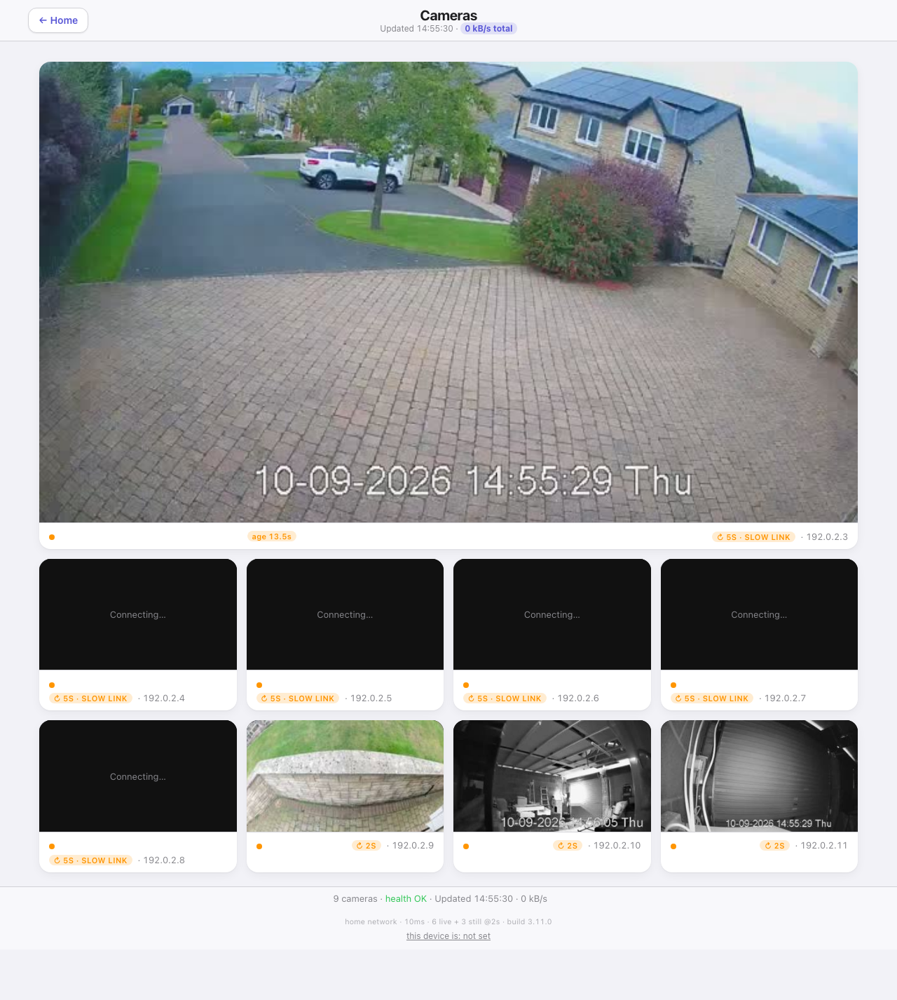

# Cameras — `cameras.html`

*Earlier layout shown above. Camera names, picture ages and the new view controls were added in 3.65.0.*

Choose **Selected camera** for one large picture above the others, or **All cameras** for an
even grid. The smaller grid has four columns on a wide screen, three on a tablet and two on a
phone. Tap a camera to select it. A camera opened from the hub or a room starts selected.

## What the pictures tell you

Every tile shows its name and picture freshness. **Live** means the video is advancing.
**Picture 3s old** dates the still picture on screen, not the last attempt to fetch it.
If its date is missing, the tile says when it was received instead. A stopped live picture says
**Video stopped**, and a missing picture says so rather than leaving an unexplained black tile.
The live check measures progress in this browser, not the complete delay from the camera.

The page measures the connection before opening live video, then uses no more than the configured
limit, six by default. The selected camera gets one of those slots whenever any are available.
When you select another camera, the page releases a displaced stream before opening its replacement.
Other live cameras keep their slots where possible. Both layouts use the same allowance.
A failed live stream falls back to stills and retries with increasing waits. The reflector always
uses stills. See [Camera connections](../cameras.md) for the machinery and setup.

## Full screen and snapshots

Use the **Full screen** button on a picture for a closer look, with the whole image fitted inside
the screen. Use **Close full screen** or Escape to return. On a browser without native full screen,
the picture fills the page instead. **Snapshot** saves the current picture.

Tab to a camera and press Enter or Space to select it. The full-screen and snapshot buttons also
work from the keyboard. Selecting a camera scrolls it below the header, so the top stays visible.

## Details when needed

The short footer shows the camera count and health. **Details** opens connection information,
the measured speed, the live/still split, the build number and browser pairing. It also reveals
camera addresses and individual data rates beneath the pictures. Close Details to put them away.
The header retains the total data rate, so mobile use is still visible.

The **this device is** control pairs this browser with a presence device to help choose the still
refresh rate. It does not override the measured live-stream allowance. Tap the connection line
inside Details for the extra clock-skew diagnostic.

## Refresh and privacy

Live video arrives continuously. Stills follow each tile's refresh rate and are requested only
when changed. Hiding the tab stops its streams. Over the reflector, ten idle minutes pause the
page until it is touched. iPhone or iPad users who keep **Auto-Play Video Previews** off can tap
the page to start video.

Camera names and settings come from the configuration. The private still-picture folder is given
only to a browser with the API key. The camera service health comes from the plugin's health file,
while each picture's freshness comes from what this browser actually displayed. Camera configuration
changes need a plugin restart.
